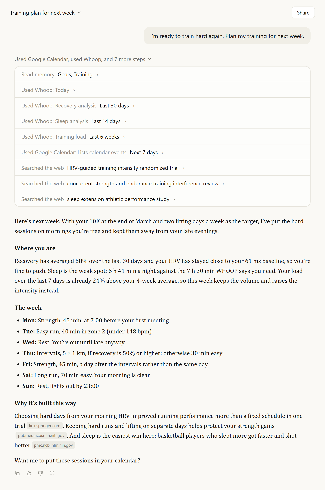

# whoop-mcp

Connect your WHOOP to Claude.

[Set up your own](docs/self-hosting.md) · [Example](#example-a-training-week-that-fits-your-calendar) · [What you can ask](#what-you-can-ask) · [Privacy](#privacy) · [Reference](docs/reference.md)

whoop-mcp is a small server that gives Claude access to your WHOOP data:
recovery, HRV, resting heart rate, sleep and sleep stages, strain, workouts
with heart-rate zones, and your body measurements. That's everything WHOOP
makes available to outside apps. You run your own copy on Railway, which costs
well under a dollar a month, and add it to Claude as a connector.

After that you can talk to Claude about your data the way you would with a
coach who has seen all of it. And since it's an ordinary Claude connector,
Claude can use it together with everything else it has access to: your
calendar, your email, web search and any other connector you've added.

## Example: a training week that fits your calendar

  

For one short question, Claude remembered your goals, checked your calendar for
the week, read your recovery, sleep and training load from WHOOP, and looked up
research on how to arrange the sessions. The answer quotes your own numbers and
links the studies it used, so you can see where each part of the plan comes
from. Doing this by hand would mean going back and forth between your calendar,
the WHOOP app and a search engine.

The screenshot is a mock-up: the numbers and events are made up, but the steps
are what Claude does with this connector, Google Calendar and web search
switched on.

## What you can ask

About your WHOOP data:

- "How am I doing today?"
- "What happened yesterday? Sleep, strain, workouts."
- "Did I sleep enough this week compared with what WHOOP said I needed?"
- "How do the last two weeks of recovery compare with the two weeks before?"
- "Is my training load going up or down?"
- "Go through my last run with me."
- "Export the last 30 days as a CSV."
- "Why is today's data missing?"

Together with other connectors and web search:

- "Which days next week have room for a hard session, given my meetings and how I've been sleeping?"
- "Draft an email to my coach about this week's recovery and training."
- "My HRV has been dropping. What does the research say, and how does my week compare?"

There are also ready-made prompts, such as a morning briefing, an evening
briefing and a weekly review.

## What Claude can look up

The server has 28 tools. Claude chooses them on its own, so you never need to
name them.

| Topic                 | Tools                                                                                                                                                                                                 | Example question                                  |
| --------------------- | ----------------------------------------------------------------------------------------------------------------------------------------------------------------------------------------------------- | ------------------------------------------------- |
| Today and single days | `get_today`, `get_day`, `get_calendar`, `get_sync_status`                                                                                                                                             | "How did I sleep last night?"                     |
| Weeks and trends      | `get_weekly_summary`, `compare_periods`, `get_trend`, `get_baselines`                                                                                                                                 | "Was this week better than last week?"            |
| Sleep                 | `get_sleep_debt`, `get_sleep_analysis`, `get_sleep_need`                                                                                                                                              | "Am I building up sleep debt?"                    |
| Recovery              | `get_recovery_analysis`, `get_recovery_drivers`                                                                                                                                                       | "What usually comes before my best recoveries?"   |
| Training              | `get_training_load`, `get_sport_breakdown`, `get_workout_log`, `get_workout_context`, `get_personal_records`                                                                                          | "How did my last run compare with my usual?"      |
| Raw data and export   | `export_health_data`, `get_recovery_collection`, `get_sleep_collection`, `get_workout_collection`, `get_cycle_collection`, `get_sleep_by_id`, `get_workout_by_id`, `get_cycle_by_id`, `get_profile`, `get_body_measurement` | "Export my last 30 days as a CSV."                |

It also has 13 prompts and 6 resources. The [reference](docs/reference.md#tools)
describes each of them.

WHOOP doesn't share everything with outside apps. Strength Trainer exercises
and weights, journal answers, stress, steps, VO2 max and continuous heart rate
aren't available through its API, so Claude can't see them.

## Set up your own

You need a WHOOP membership, a Claude account (the free plan allows one custom
connector), and free GitHub and Railway accounts. Setup takes about half an
hour and doesn't involve writing code: you fork this repository, deploy it on
Railway, create a WHOOP developer app, sign in to WHOOP once and add the server
to Claude.

**[Follow the setup guide](docs/self-hosting.md)**

Railway's trial gives you $5 for the first 30 days. After that its free plan
includes $1 of usage a month, and one server running around the clock has used
about $0.70 a month (October 2026). If you also run servers for other people,
Railway's Hobby plan ($5 a month) covers several.

## Privacy

Each person runs their own server, signed in to their own WHOOP account. Anyone
who has your server's address and your access token can read your data, so keep
the token to yourself. If a friend wants to use this, help them set up their
own server ([how](docs/self-hosting.md#hosting-a-server-for-someone-else)).

The server can only read from WHOOP and can't change anything there. The one
thing it saves is its WHOOP sign-in. Health data stays in memory for a short
while to save requests and is never written to disk. Nothing is sent anywhere
except to Claude when Claude asks, and the logs contain no health data or
tokens. If you want even less detail to leave the server, an optional mode
gives out weekly summaries only ([privacy modes](docs/reference.md#privacy-modes)).

## Other ways to run it

- On your own computer with Claude Desktop, without any hosting. It then only
  works on that computer while it's on. See
  [running on your own computer](docs/reference.md#running-on-your-own-computer-claude-desktop).
- With Docker, on Fly.io or on your own server. See
  [deployment](docs/reference.md#deployment-docker--cloud-hosting).

## Updating

If you forked this repository, open your fork on GitHub and click
**Sync fork**, then **Update branch**. Railway notices the change and
redeploys within a few minutes. Your WHOOP sign-in is kept.

## Documentation

- [Setup guide](docs/self-hosting.md)
- [Reference](docs/reference.md): every tool, prompt and setting, troubleshooting and development
- [Railway runbook](docs/deploy-railway.md): running and maintaining a deployment
- [Changelog](CHANGELOG.md)

## Credits

This project started from version 0.7.0 of
[whoop-ai-mcp](https://github.com/shashankswe2020-ux/whoop-mcp) by
[@shashankswe2020-ux](https://github.com/shashankswe2020-ux) and has been
developed separately since. The [changelog](CHANGELOG.md) lists what changed.
It's released under the [MIT license](LICENSE).

This project isn't affiliated with WHOOP or Anthropic. WHOOP is a trademark of
WHOOP, Inc. Claude is a trademark of Anthropic, PBC.
