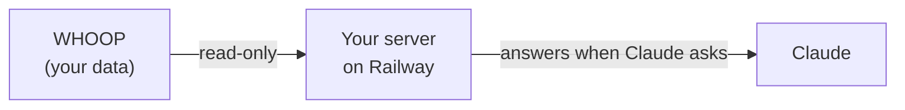

# Set up your own WHOOP server for Claude

This guide walks you through setting up your own server and connecting it to
Claude, up to the point where you ask _"How am I doing today?"_ and get an
answer from your own WHOOP data. It takes about half an hour. You won't write
any code; you'll copy a few values between GitHub, Railway, WHOOP and Claude.



Your server runs on [Railway](https://railway.com), a hosting service. It signs
in to WHOOP once with your account and then answers Claude's questions about
your data. Nobody else uses it.

**Contents:** [What you need](#what-you-need) ·
[1. Copy the code](#1-copy-the-code-to-your-github) ·
[2. Create the server](#2-create-the-server-on-railway) ·
[3. WHOOP developer app](#3-create-a-whoop-developer-app) ·
[4. Access token](#4-make-an-access-token) ·
[5. Settings](#5-add-the-settings-and-deploy) ·
[6. Sign in to WHOOP](#6-sign-in-to-whoop-once) ·
[7. Connect Claude](#7-add-your-server-to-claude) ·
[Costs](#costs-and-railway-plans) ·
[Updates](#keeping-it-up-to-date) ·
[Troubleshooting](#troubleshooting) ·
[A server for someone else](#hosting-a-server-for-someone-else)

## What you need

- A **WHOOP** membership.
- A **Claude** account. The free plan allows one custom connector, which is all you need.
- A free **[GitHub](https://github.com/signup)** account.
- A **[Railway](https://railway.com)** account. You can sign up with your GitHub account. New accounts get a free trial; see [costs](#costs-and-railway-plans).
- A text file or notes app to keep a few values in while you work. You will collect:
  - your server's **address**,
  - your WHOOP app's **Client ID** and **Client Secret**,
  - an **access token** you make in step 4.

Treat the Client Secret and the access token like passwords.

## 1. Copy the code to your GitHub

1. Sign in to GitHub and open **https://github.com/AstraRus/whoop-mcp**.
2. Click **Fork** (top right), then **Create fork**.

You now have your own copy at `https://github.com/<your-username>/whoop-mcp`.
Railway builds your server from it, and you decide when to take updates (see
[keeping it up to date](#keeping-it-up-to-date)).

## 2. Create the server on Railway

1. Sign in at **[railway.com](https://railway.com)** (with GitHub is easiest).
2. Click **+ New** (or **New Project**), then **GitHub Repository**.
   - If your copy is not in the list, click **Configure GitHub App** and give
     Railway access to the `whoop-mcp` repository, then come back.
3. Choose **`<your-username>/whoop-mcp`**. Railway creates a service and starts
   building it. **The first deploy fails or keeps waiting. That's expected:**
   the server has no settings yet.

### Give it an address

4. Click the service box, then **Settings → Networking → Public networking →
   Generate Domain**. If the button isn't there yet, wait until the first
   deploy has finished, then reload the page.
5. Enter port **`3000`** and click **Generate Domain**.
6. Copy the address it shows, something like
   `whoop-mcp-production-ab12.up.railway.app`. This is **your address** in the
   rest of this guide.

### Give it storage

7. Right-click the service box on the project canvas and choose
   **Attach volume**.
8. Type **`/data`** as the mount path and press Enter.

The volume keeps your WHOOP sign-in when the server restarts or updates. Each
server needs its own volume; never share one between two servers.

## 3. Create a WHOOP developer app

The app is how your server is allowed to read your WHOOP data. It's free.

1. Open **[developer-dashboard.whoop.com](https://developer-dashboard.whoop.com)**
   and sign in with your WHOOP account.
2. Click **Create new app** and fill it in:

   | Field              | What to enter                                                                                                                                                         |
   | ------------------ | --------------------------------------------------------------------------------------------------------------------------------------------------------------------- |
   | **Name**           | Anything, for example `Claude`                                                                                                                                        |
   | **Contacts**       | Your email address                                                                                                                                                    |
   | **Privacy Policy** | The address of your copy, `https://github.com/<your-username>/whoop-mcp`                                                                                              |
   | **Redirect URLs**  | `https://<your address>/callback`, for example `https://whoop-mcp-production-ab12.up.railway.app/callback`                                                            |
   | **Scopes**         | Tick all six: `read:recovery`, `read:cycles`, `read:sleep`, `read:workout`, `read:profile`, `read:body_measurement`                                                   |
   | **Webhooks**       | Leave empty                                                                                                                                                           |

3. Save. Copy the **Client ID** and the **Client Secret** (click the eye icon to
   reveal it).

New apps start in WHOOP's _Sandbox_ status, which allows up to 10 WHOOP
accounts. That's plenty for personal use; you don't need to apply for more.

## 4. Make an access token

Claude will send this token with every request, and your server answers only
requests that carry it. Make a long random one:

- **Windows:** open **PowerShell** (Start menu → type `PowerShell`), paste this
  line and press Enter:

  ```powershell
  $b = New-Object byte[] 32; [Security.Cryptography.RandomNumberGenerator]::Create().GetBytes($b); -join ($b | ForEach-Object { $_.ToString('x2') })
  ```

- **Mac or Linux:** open **Terminal**, paste this and press Enter:

  ```bash
  openssl rand -hex 32
  ```

Either prints 64 letters and digits. Copy them; that's your **access token**.

## 5. Add the settings and deploy

1. In Railway, click your service, open **Variables**, then **Raw Editor**.
2. Paste this, then replace the three `paste-…` values with yours (keep
   everything else exactly as it is):

   ```env
   WHOOP_CLIENT_ID=paste-your-client-id
   WHOOP_CLIENT_SECRET=paste-your-client-secret
   MCP_AUTH_TOKEN=paste-your-access-token
   WHOOP_REDIRECT_URI=https://${{RAILWAY_PUBLIC_DOMAIN}}/callback
   WHOOP_MCP_TOKEN_DIR=/data
   MCP_TRUST_PROXY=1
   CALLBACK_HOST=0.0.0.0
   CALLBACK_TIMEOUT_MS=900000
   ```

   `${{RAILWAY_PUBLIC_DOMAIN}}` is filled in by Railway with your address, so
   leave it as it is.

3. Click **Update Variables**.
4. Click the purple **Deploy** button at the top left of the project canvas to
   apply the changes.

What the other lines do: `WHOOP_MCP_TOKEN_DIR` keeps the WHOOP sign-in on the
volume, `MCP_TRUST_PROXY` tells the server it runs behind Railway's proxy, and
`CALLBACK_HOST` with `CALLBACK_TIMEOUT_MS` let the one-time WHOOP sign-in in the
next step reach the server and give you 15 minutes to finish it. Every setting
is explained in the [reference](reference.md#environment-variables).

## 6. Sign in to WHOOP (once)

1. In Railway, open **Deployments**, then click **View logs** on the newest
   deployment.
2. Wait about a minute until you see the line
   `If the browser didn't open, visit:`. Copy the long link below it. It starts
   with `https://api.prod.whoop.com/oauth/oauth2/auth` and contains your
   address.
3. Open the link in your browser, sign in with **your** WHOOP account and allow
   access.
4. The page confirms the sign-in, and the logs show
   `whoop authentication complete` and `http transport listening`.

The link works for 15 minutes. If it has expired, the server restarts by itself
and prints a new one; copy the newest link from the logs. You can also click
**⋮ → Redeploy** on the deployment to get a fresh link.

**Check:** open `https://<your address>/health` in your browser. It should show
`{"status":"ok"}`.

You only sign in once. The server keeps the sign-in on its volume and renews it
by itself.

## 7. Add your server to Claude

1. Open **[claude.ai](https://claude.ai)** and click **Customize** in the left
   sidebar, then **Connectors**.
2. Click **+ Add**, then **Add custom connector**.
3. Fill in:
   - **Name:** `WHOOP`
   - **MCP server URL:** `https://<your address>/mcp`
4. Click **Continue**. If Claude says it couldn't check the server or couldn't
   tell how it signs in, click **Continue anyway**.
5. Under **Authentication**, choose **No sign-in**.
6. Under **Request headers**, click **Add header** and fill in:
   - **Header name:** `Authorization`
   - **Value:** `Bearer ` followed by your access token: the word `Bearer`, one
     space, then the 64 characters, for example
     `Bearer 3f9a…` (your full token, not the dots)
7. Click **Add**.

**Try it:** open a new chat, make sure the WHOOP connector is switched on (the
**+** menu in the message box, then **Connectors**), and ask:

> _How am I doing today?_

The connector is saved to your Claude account, so it also works in the Claude
desktop app when you're signed in to the same account.

It gets more useful next to your other connectors. With Google Calendar
switched on as well, you can ask something like _"Based on my WHOOP data and
my calendar, plan my training for next week"_, and Claude will check both
(and search the web for research if you ask it to).

**If you've only just started wearing WHOOP:** WHOOP spends the first days
calibrating. Some values are missing or marked as calibrating until then, and
Claude says so instead of guessing.

## Costs and Railway plans

Prices and plans as of October 2026; check [Railway's pricing](https://railway.com/pricing)
for the current ones.

- **Trial:** new Railway accounts get $5 of credit for 30 days.
- **After the trial**, choose a plan under **Workspace → Plans** (if the free
  plan isn't offered yet, it appears there once the trial has ended):
  - **Free:** $1 of usage included every month. One server running around the
    clock used about $0.70 a month in our measurements, so it fits.
  - **Hobby:** $5 a month, which includes $5 of usage: enough for several
    servers, for example one per family member.
- To check your own usage, open **Usage** in Railway's workspace menu.
- If the free credit ever gets tight, **Settings → Serverless** lets the server
  sleep when unused. The first question after a pause then takes a few seconds
  longer, and may fail once; asking again works.

If you let the trial run out without choosing a plan, Railway pauses the server.
If your server ever shows a WHOOP sign-in link in its logs again, for example
because its storage was removed, just repeat [step 6](#6-sign-in-to-whoop-once).

## Keeping it up to date

When this repository gets updates, GitHub shows them on your copy's page as
"This branch is N commits behind". To update:

1. Open your copy on GitHub.
2. Click **Sync fork → Update branch**.

Railway notices the change, rebuilds and restarts your server within a few
minutes. Your WHOOP sign-in, settings and connector stay as they are.

## Troubleshooting

| What you see                                                                         | What to do                                                                                                                                                                                                                                                      |
| ------------------------------------------------------------------------------------ | --------------------------------------------------------------------------------------------------------------------------------------------------------------------------------------------------------------------------------------------------------------- |
| No `Generate Domain` button                                                          | Wait for the first deploy to finish (it may fail; that's fine), then reload the page.                                                                                                                                                                           |
| The sign-in link contains `https%3A%2F%2F%2Fcallback` (no address)                   | The address was created after this deploy started. Click **⋮ → Redeploy** and use the new link.                                                                                                                                                                 |
| WHOOP's page says the redirect URL is invalid                                        | The redirect URL in your WHOOP app must be exactly `https://<your address>/callback`: https, your address, `/callback`, no extra slash or space.                                                                                                                 |
| Logs say `Missing required environment variable`                                     | A setting from step 5 is missing or misspelled. Open **Variables → Raw Editor** and compare with step 5.                                                                                                                                                        |
| The server asks for a WHOOP sign-in again after every deploy                         | The volume isn't mounted at `/data`, or `WHOOP_MCP_TOKEN_DIR` isn't `/data`. Fix it, redeploy and sign in once more.                                                                                                                                             |
| `/health` doesn't load or shows `404`                                                | The server is still waiting for the WHOOP sign-in (step 6), or the domain's port isn't `3000` (**Settings → Networking**, edit the domain).                                                                                                                     |
| Claude can't connect, or says unauthorized                                           | The URL must end in `/mcp`. The header name must be `Authorization` and the value `Bearer`, one space, then the exact token from `MCP_AUTH_TOKEN`. Remove the connector and add it again if unsure; saved header values can't be viewed.                       |
| Claude says data is missing or calibrating                                           | Normal in the first days of wearing WHOOP, and for today before WHOOP has scored your sleep. Ask _"Why is today's data missing?"_ for the details.                                                                                                              |
| Anything else                                                                        | See the [reference's troubleshooting](reference.md#troubleshooting) and the [Railway runbook](deploy-railway.md).                                                                                                                                               |

To change your access token later: put a new one in `MCP_AUTH_TOKEN`, deploy,
then remove the connector in Claude and add it again with the new token.

## Hosting a server for someone else

Every person needs their own server, because a server holds exactly one WHOOP
sign-in. If you want to run one for a friend or family member in your Railway
project, you can reuse your WHOOP developer app:

1. In your Railway project, click **+ Add → GitHub Repository** and choose your
   copy again. Rename the new service (for example `whoop-mcp-anna`) by
   clicking its name at the top of its panel.
2. Give it **its own** address (port `3000`) and **its own** volume at `/data`,
   as in [step 2](#2-create-the-server-on-railway).
3. In your WHOOP app, add a second redirect URL:
   `https://<their address>/callback`. Keep yours.
4. Make a **new** access token for them (step 4) and paste these variables into
   the new service. The first two lines copy your WHOOP app's credentials from
   your service; replace `whoop-mcp` with your service's name if it differs:

   ```env
   WHOOP_CLIENT_ID=${{whoop-mcp.WHOOP_CLIENT_ID}}
   WHOOP_CLIENT_SECRET=${{whoop-mcp.WHOOP_CLIENT_SECRET}}
   MCP_AUTH_TOKEN=paste-their-new-access-token
   WHOOP_REDIRECT_URI=https://${{RAILWAY_PUBLIC_DOMAIN}}/callback
   WHOOP_MCP_TOKEN_DIR=/data
   MCP_TRUST_PROXY=1
   CALLBACK_HOST=0.0.0.0
   CALLBACK_TIMEOUT_MS=900000
   WHOOP_RATE_LIMIT_PER_MINUTE=40
   ```

   `WHOOP_RATE_LIMIT_PER_MINUTE=40` keeps both servers together within WHOOP's
   limit of 100 requests a minute per developer app (yours uses 60 by default).

5. Deploy, then send them the sign-in link from the new service's logs. **They**
   open it and sign in with **their** WHOOP account. If you opened it yourself,
   it would connect your WHOOP account to their server.
6. They add the connector in their own Claude account (step 7) with their
   address and their token.

A WHOOP app in Sandbox status allows up to 10 WHOOP accounts.

---

Back to the [README](../README.md) · Full details in the [reference](reference.md)
